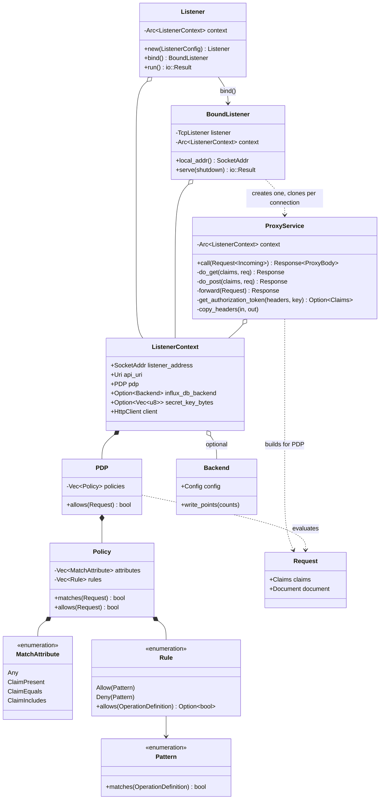
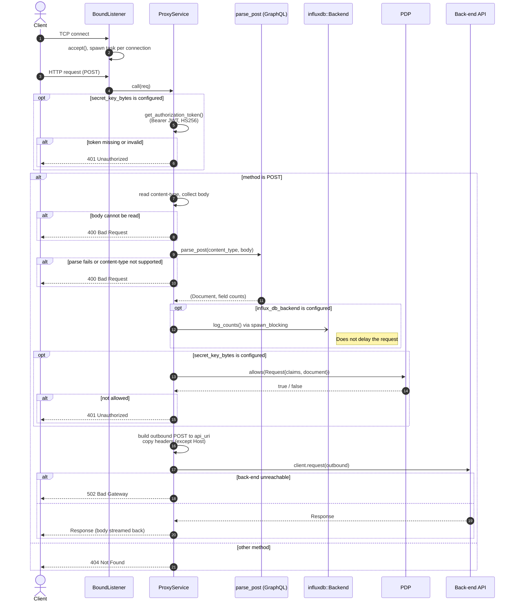

# Proxy call flow

This document describes how Arboric handles one HTTP request. It follows the
request from the client, through the proxy, to the back-end GraphQL API, and
back to the client.

## Overview

1. `arboric start` reads the YAML configuration and builds a `Listener`.
2. `Listener::run` binds a TCP socket and accepts connections.
3. Each connection is served by a `ProxyService` through hyper.
4. `ProxyService::call` checks the JWT (if a signing key is configured).
5. `GET` requests are forwarded without further checks.
6. `POST` requests are parsed as GraphQL, counted, checked by the PDP, and
   then forwarded.
7. The back-end response is streamed back to the client.

| Source file                      | Role                                        |
| -------------------------------- | ------------------------------------------- |
| `src/bin/arboric.rs`             | CLI entry point; loads config, starts proxy |
| `src/arboric/listener.rs`        | Binds the socket, accepts connections       |
| `src/arboric/proxy_service.rs`   | Handles each request                        |
| `src/arboric.rs`             | `parse_post`, `log_counts`                  |
| `src/arboric/abac.rs`        | Access control (`PDP`, `Policy`, `Rule`)    |
| `src/arboric/graphql/pattern.rs` | GraphQL patterns used by rules              |
| `src/arboric/influxdb.rs`    | Optional query metrics                      |

## Class diagram

`ListenerContext` is shared through an `Arc`. It is read-only after start-up,
so all connections use it without locks.

## Sequence diagram

The diagram shows a `POST` request. It is the main path, because it is the
only one that runs GraphQL parsing and access control.

## Step by step

### 1. Start-up

`main` in `src/bin/arboric.rs` loads the YAML file with
`read_yaml_configuration`. It takes the first listener configuration and calls
`Listener::new`. This does the following:

- Reads the JWT signing key (if configured) into `secret_key_bytes`.
- Builds one shared hyper HTTP client for the back-end.
- Wraps everything in an `Arc<ListenerContext>`.

`Listener::run` calls `bind`, then `serve`. It stops on Ctrl-C.

### 2. Accept

`BoundListener::serve` loops on `TcpListener::accept`. For each connection it:

1. Clones the `ProxyService` (this only clones the `Arc`).
2. Serves the connection with hyper `auto::Builder` (HTTP/1 or HTTP/2).
3. Registers the connection with `GracefulShutdown`.
4. Spawns a Tokio task for it.

On shutdown the listener stops accepting. It waits up to 10 seconds
(`SHUTDOWN_TIMEOUT`) for open connections to finish.

### 3. Authentication

`ProxyService::call` runs first for every request. If `secret_key_bytes` is
set, it reads the `Authorization: Bearer <jwt>` header. It decodes the token
with HS256 and keeps the claims. Any failure returns `401`.

If no key is configured, the proxy does not check tokens and does not run the
PDP.

> **Note:** the token is decoded with `ValidationOptions::dangerous()`. This
> checks the signature, but not claims such as expiry.

### 4. Routing by method

| Method  | Handler     | Result                                      |
| ------- | ----------- | ------------------------------------------- |
| `GET`   | `do_get`    | Forwarded to `<api_uri host>/graphql?<query>` |
| `POST`  | `do_post`   | Parsed, counted, checked, forwarded         |
| Other   | -           | `404 Not Found`                             |

`do_get` does not parse the query. It does not run the PDP or the metrics
code. The JWT check in step 3 is the only check for `GET`.

### 5. POST processing

`do_post` does the following:

1. **Read the body.** It collects the full body into memory. If this fails, it
   returns `400`.
2. **Parse.** `parse_post` chooses a parser from `Content-Type`:
   - `application/graphql`: the body is the query.
   - `application/json`: the `query` field of the JSON body is the query.
   - No content type: the proxy tries `application/graphql`.
   - Any other type: no document, so the proxy returns `400`.

   The result is a `graphql_parser` `Document` and a map of top-level field
   names to counts.
3. **Metrics (optional).** `log_counts` sends the counts to InfluxDB in a
   `spawn_blocking` task. The request does not wait for it.
4. **Access control (only with a signing key).** The proxy builds an
   `arboric::Request { claims, document }` and calls `PDP::allows`:
   - The PDP returns `false` if it has no policies.
   - It keeps the policies whose `MatchAttribute`s all match the claims.
   - It allows the request if any of those policies allows it.
   - A policy allows a request if every operation passes all its matching
     rules. A matching `Deny` rule rejects the request.

   A rejected request gets `401`.
5. **Forward.** The proxy builds a `POST` to `api_uri` with the original body.
   It copies all headers except `Host`.

### 6. Forward and respond

`ProxyService::forward` sends the request with the shared hyper client.

- On success, the back-end response (status, headers, body) goes to the
  client. The body is streamed, not buffered.
- If the back-end cannot be reached, the proxy returns `502 Bad Gateway`.

`call` never returns an error (its error type is `Infallible`). Every failure
becomes an HTTP status code.

## Status codes

| Status | Cause                                                          |
| ------ | -------------------------------------------------------------- |
| `400`  | Body unreadable, GraphQL parse error, or unsupported type      |
| `401`  | Missing or invalid JWT, or PDP denied the request              |
| `404`  | Method is not `GET` or `POST`                                  |
| `502`  | Back-end API could not be reached                              |
| Other  | Passed through from the back-end API                           |
